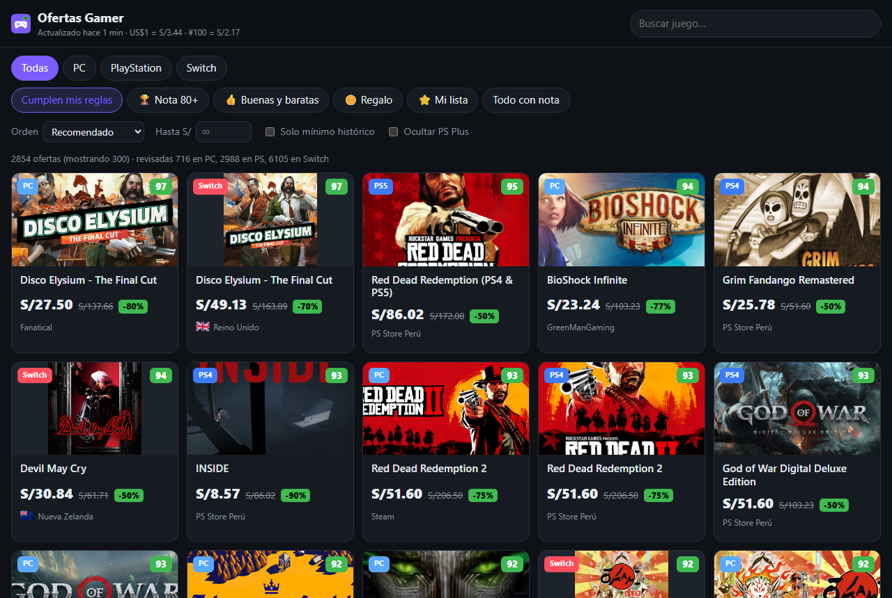
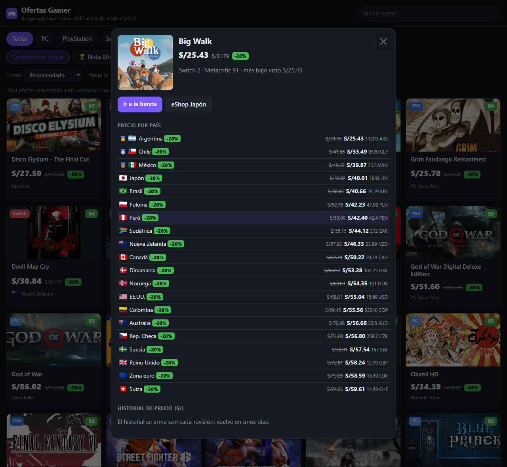
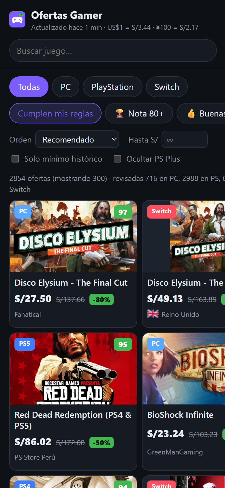
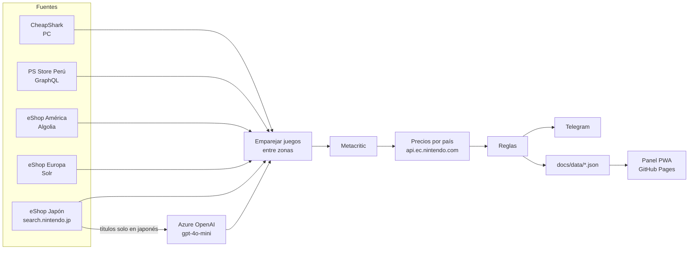

<div align="center">


# Ofertas Gamer

**Ofertas de juegos que valen la pena, en PC, PlayStation y Nintendo Switch, con aviso por Telegram en cuanto aparecen.**

[](https://github.com/CarlosM0905/ofertas-gamer/actions/workflows/scan.yml)


[**Abrir el panel →**](https://carlosm0905.github.io/ofertas-gamer/)



</div>

---

## Por qué

Hay miles de ofertas al día y casi todas son juegos que no valen la pena. Ofertas Gamer revisa las tiendas cada 2 horas, cruza cada oferta con su nota en Metacritic y solo te avisa de las que cumplen tus reglas. En Switch, además, compara el precio en 20 países (incluido Japón) y te dice dónde sale más barato.

## Qué hace

| | |
|---|---|
| 🖥️ **PC** | Steam, GOG, Epic, Humble, Fanatical, GreenManGaming y más (vía CheapShark), con el **mínimo histórico real**. |
| 🎮 **PlayStation** | PS Store **Perú**, juegos de PS5 y PS4. Marca los descuentos que solo valen con PS Plus. |
| 🍄 **Switch / Switch 2** | eShop de **20 países**: América, **Japón**, Europa, Australia, Nueva Zelanda y Sudáfrica. Precio por país convertido a soles. |
| 🈶 **Japón sin barreras** | Los juegos que en Japón solo tienen nombre en japonés se traducen a su título oficial occidental con Azure OpenAI para emparejarlos y darles nota. |
| ⭐ **Notas** | Metacritic para cada juego, con caché. |
| 🔔 **Telegram** | Aviso de ofertas nuevas, resumen diario a las 8 am y lista de seguimiento por comandos. |
| 📈 **Historial** | Curva de precio por juego y aviso de "mínimo histórico". |
| 📱 **PWA** | Panel instalable en el celular, con filtros, búsqueda y modo offline. |

<table>
<tr>
<td width="62%"></td>
<td></td>
</tr>
<tr>
<td align="center"><sub>Precio de un juego en los 20 países, del más barato al más caro</sub></td>
<td align="center"><sub>Panel en el celular</sub></td>
</tr>
</table>

## Reglas de aviso

Todo se ajusta en [`config.json`](config.json) → `reglas`.

| Nivel | Condición |
|---|---|
| 🏆 **Top** | Nota Metacritic **≥ 80** y al menos **20%** de descuento |
| 👍 **Buena y barata** | Nota **60–79** y precio **≤ S/35** |
| 🪙 **Regalo** | Nota **< 60** y precio **≤ S/12** |
| ⭐ **Mi lista** | Juegos que sigues, con **cualquier** descuento |

- Sin nota conocida no avisa, salvo que el juego esté en tu lista.
- En Switch cuenta el país más barato; el aviso también muestra el precio en Perú.
- Vuelve a avisar del mismo juego solo si baja otro 5% o más.
- Cada aviso trae un enlace a la tienda y otro a la ficha del juego en el panel.

## Telegram

| Comando | Qué hace |
|---|---|
| `/seguir nombre` | Avisarme de ese juego con cualquier descuento |
| `/dejar nombre` | Dejar de seguirlo |
| `/lista` | Ver mi lista |
| `/resumen` | Mandar ahora lo mejor del momento |

Los comandos se leen en cada revisión (cada 2 h), así que la respuesta puede tardar.

## Cómo funciona



GitHub Actions corre [`src/main.js`](src/main.js) cada 2 horas y guarda los resultados en el repo. El panel es HTML y JS sin compilar, servido por GitHub Pages desde `/docs`.

**Cuidados con las APIs:**
- **Nintendo** bloquea la IP (403) si recibe muchos pedidos seguidos. Los precios por país se guardan en caché, cada corrida hace como máximo 200 llamadas de a una, y al primer 403 se detiene y usa lo que ya tiene. Mientras se llena el caché (unas 3 corridas) el bot no avisa, para no mandarte cientos de "ofertas nuevas".
- **Metacritic**: las notas se guardan en `state/scores.json`. Para los títulos traducidos por IA solo se acepta una coincidencia exacta del nombre, así una mala traducción no le pone a un juego la nota de otro.
- **Traducciones**: cada título japonés se traduce una sola vez (`state/jp-titles.json`).

## Puesta en marcha

### 1. Bot de Telegram

1. Habla con [@BotFather](https://t.me/BotFather), envía `/newbot` y guarda el **token**.
2. Escríbele cualquier mensaje a tu bot nuevo.
3. Obtén tu **chat ID**:
   ```bash
   TELEGRAM_TOKEN=tu_token npm run chat-id
   ```

### 2. Secrets del repo

Settings → Secrets and variables → Actions, o con la CLI de GitHub:

```bash
gh secret set TELEGRAM_TOKEN
gh secret set TELEGRAM_CHAT_ID
gh secret set AZURE_OPENAI_ENDPOINT
gh secret set AZURE_OPENAI_API_KEY
gh secret set AZURE_OPENAI_DEPLOYMENT
```

Azure es opcional: sin esos secrets todo funciona, salvo la traducción de títulos japoneses.

### 3. Correr en local

```bash
npm ci
npm run scan:dry   # revisa todo e imprime los avisos sin mandarlos
npm run scan       # igual, pero manda a Telegram si están las variables
npm test
npm run serve      # panel en http://localhost:8080
```

## Configuración

| Clave | Para qué |
|---|---|
| `reglas` | Notas, descuento mínimo y precios máximos de cada nivel |
| `pc.tiendas` / `pc.paginas` | IDs de tiendas de CheapShark y cuántas páginas leer |
| `ps` | Categoría de ofertas, idioma y plataformas de la PS Store |
| `preciosSwitch` | Llamadas por corrida, horas de vigencia del caché y pausa entre llamadas |
| `notas` | Búsquedas en Metacritic por corrida y cada cuántos días reintentar los juegos sin nota |
| `traduccion` | Títulos a traducir por corrida y tamaño de lote |
| `telegram.maxPorMensaje` | Máximo de ofertas por aviso |

## Estructura

```
src/
  main.js                 orquesta: comandos, fuentes, notas, reglas, avisos y guardado
  sources/pc.js           CheapShark
  sources/playstation.js  PS Store Perú
  sources/nintendo.js     las 3 zonas de la eShop, emparejamiento y precios por país
  scores.js               Metacritic
  translate.js            títulos japoneses → inglés (Azure OpenAI)
  rules.js                niveles y cuándo volver a avisar
  telegram.js             envío y comandos
tools/chat-id.js          muestra tu chat ID de Telegram
docs/                     panel PWA (GitHub Pages)
  data/                   deals.json e history.json (los genera el bot)
state/                    cachés y estado del bot
tests/                    node:test
```

## Limitaciones

- **Asia** (Hong Kong, Taiwán, Corea, Singapur, Tailandia, Malasia): no tienen un catálogo de ofertas público accesible.
- **Juegos solo de Japón**: si no salieron en Occidente, no tienen nota y no generan avisos (salvo que los sigas).
- **PS Store**: usa una consulta interna; si Sony la cambia, la corrida lo reporta como error.
- **Argentina y EE.UU.** muestran precios sin impuestos.
- **Historial**: PC trae el mínimo histórico real; en PS y Switch la curva empieza el día en que arrancó el bot.

<div align="center"><sub>Proyecto personal. Los datos de precios son públicos y pertenecen a cada tienda.</sub></div>
